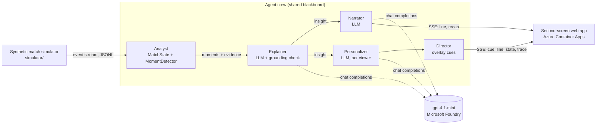

# Inside the Game: Synthetic Match Insights Engine

Entry for the Microsoft x Premier League **Inside the Game: Developer Hackathon**.

A synthetic match streams live. A team of AI agents turns the events into stats, explains why key moments matter, writes commentary and recaps, and personalizes everything for analysts and casual fans in any language, rendered as timed overlays next to the match.

> All clubs, players and matches in this repository are fictional and generated by code. No real Premier League data is used.

**Live demo:** https://itg-second-screen.blackdesert-df352da7.canadacentral.azurecontainerapps.io · **Video:** _coming soon_

## Architecture



How it maps to the challenge pipeline:

| Stage | Where |
| --- | --- |
| **Ingest** | `simulator/` emits a live event stream; the web app and CLIs consume it event by event |
| **Interpret** | Analyst agent: `insights/` keeps match state and detects moments with the numbers behind them |
| **Explain** | Explainer agent on Microsoft Foundry, checked against the evidence for invented numbers |
| **Render** | Director agent turns insights into timed overlay cues; the web app draws them on the live pitch |
| **Personalize** | Personalizer agent per viewer: mode, language, favourite club and player |

## Responsible AI

- Every number the Explainer writes is checked against the moment's evidence. Ungrounded answers get one retry with feedback, then a deterministic, grounded fallback.
- All data is synthetic and fictional, so no real players or personal data are involved.
- The *Agents* tab shows every handoff and model call, so viewers can see where each insight came from.
- Tests and CI run in offline mode and never call the model.

## Status

- [x] Synthetic match simulator and open event dataset
- [x] Live match state and explainable moment detection
- [x] Multi-agent crew: explainer, narrator, personalizer, director (offline mode + Foundry model)
- [x] Web app (live pitch, overlay cues, analyst/fan/kids/player modes, 8 languages)
- [x] Model on Microsoft Foundry (`gpt-4.1-mini`, Azure OpenAI)
- [x] Public deployment on Azure Container Apps

## Synthetic match simulator

`simulator/` is a dependency-free Python engine that plays a full 90-minute match one on-ball action at a time. Team tactics (pressing, tempo, directness, width), player attributes and a momentum value that drifts during the match decide which actions happen and how often they succeed, so every match has its own story: pressing spells, momentum swings, late goals.

```bash
python -m simulator generate --home NBR --away ASH --seed 7 -o data/match.jsonl
python -m simulator summary data/match.jsonl
python -m simulator replay data/match.jsonl --speed 20   # stream in accelerated real time
```

Clubs: `NBR` Northbridge Rovers, `ASH` Ashford Athletic, `KES` Kestrel City, `HBS` Harbourside United.

### Event schema (one JSON object per line)

| Field | Meaning |
| --- | --- |
| `t` | Elapsed playing seconds since kick-off, monotonic across halves |
| `period`, `minute`, `second` | Match clock (second half starts at 45:00, stoppage time keeps counting) |
| `type` | `match_start`, `kickoff`, `pass`, `carry`, `sprint`, `take_on`, `pressure`, `tackle`, `interception`, `ball_recovery`, `possession_change`, `shot`, `save`, `goal`, `foul`, `card`, `free_kick`, `corner`, `throw_in`, `goal_kick`, `period_end`, `match_end` |
| `team_id`, `player_id`, `related_player_id` | Who acted, and the receiver / opponent involved |
| `x`, `y`, `end_x`, `end_y` | Metres on a 105 x 68 pitch. Home always attacks towards x = 105 |
| `outcome` | e.g. `complete`/`incomplete`, `goal`/`saved`/`blocked`/`off_target`, `won`/`foul` |
| `metrics` | Per-event numbers (below) |
| `score` | Score at the moment of the event |

Metrics by event type:

- **pass**: `distance_m`, `difficulty` (0-1), `success_probability`, `ball_speed_kmh`, `progressive`, `line_breaking`, `under_pressure`, `long_ball`
- **shot**: `xg`, `shot_speed_kmh`, `distance_m`, `under_pressure`
- **carry**: `distance_m`, `top_speed_kmh`; a **sprint** event fires when a player passes 30 km/h
- **pressure**: `intensity`; **tackle** / **take_on**: win probability
- **match_start**: teams, formations, venue, weather, seed

Sample matches live in `data/`. Typical output per match: ~1,100 passes at 75-82% completion, 20-30 shots, 2-5 total xG.

## Live match intelligence

`insights/` turns the event stream into shared match state and explainable moments, one event at a time, so it works the same live and post-match.

- **`MatchState`** keeps team and player aggregates: possession (by time on the ball), pass accuracy, progressive passes, shots, xG, PPDA, pressures, top speed, sprints, and a rolling five-minute window with xG, field tilt and turnover rate.
- **`MomentDetector`** flags what is worth talking about and attaches the numbers that explain it:

| Moment | Fires when | Evidence in `why` |
| --- | --- | --- |
| `goal` | Every goal | xG, shot speed, game state (opener, equaliser, go-ahead...), against-the-odds flag |
| `big_chance`, `key_save` | Shot or save with xG of 0.25 or more | xG, outcome, distance |
| `momentum_shift` | A team's five-minute field tilt jumps to 70% or more | Tilt before and after, recent xG |
| `pressing_spell` | 18 or more pressures in five minutes | Pressures, turnovers won, PPDA |
| `control` / `chaos` | 10-pass chains vs four or more possession changes per minute | Sequence length, possession share, change rate |
| `line_breaker` | Completed line-breaking pass with difficulty of 0.7 or more | Difficulty, success probability, receiver |
| `speed_tag` | Sprint of 34 km/h or more, shot of 110 km/h or more | Speed and threshold |
| `milestone`, `card` | 50/75 passes, brace, hat-trick, cards | Counts, accuracy |

```python
from insights import analyze
for event, moments, state in analyze(events):
    for m in moments:
        print(m.minute, m.type, m.player_name, m.why)
```

## Agent crew

`agents/` runs a crew of specialised agents over the live stream. They share one **blackboard**, so every handoff is a recorded entry the UI and the next agent can read.

| Agent | Kind | Job |
| --- | --- | --- |
| Analyst | Tool (deterministic) | Owns `MatchState` and `MomentDetector`: the numbers and the detected moments |
| Explainer | LLM | Says *why* a moment matters, citing evidence. Answers are checked for invented numbers: one retry with feedback, then a safe fallback |
| Narrator | LLM | Live commentary lines, half-time and full-time recaps, player of the match |
| Personalizer | LLM | Decides if a moment is worth showing to each viewer and rewrites it for their mode (`analyst`, `casual`, `kids`, `player_focus`), language, favourite club and favourite player |
| Director | Tool (deterministic) | Turns each personalized insight into a timed overlay cue (`t_in`, `duration_s`, `layout`, colours, stat chips) |

If the model is unreachable, every LLM agent falls back to grounded templates, so the broadcast never goes blank.

```bash
python -m agents data/sample_match_NBR_ASH.jsonl --live --speed 30   # watch cues per viewer
python -m agents data/sample_match_NBR_ASH.jsonl -o out/board.json   # full blackboard + trace
```

Model: set `AZURE_OPENAI_ENDPOINT`, `AZURE_OPENAI_API_KEY` and `AZURE_OPENAI_DEPLOYMENT` for a model deployed in Microsoft Foundry (we run `gpt-4.1-mini`, Global Standard). Without them (or with `INSIGHTS_OFFLINE=1`) the crew runs on offline templates in English and Spanish.

The crew is split in two so it can run live: `observe()` is the deterministic Analyst (state and moments, microseconds per event) and `react()` runs the LLM agents on what it found. Narrator and personalizers work on the same insight in parallel, so a moment costs two model round trips whatever the number of viewers.

Measured on the sample match with `gpt-4.1-mini` and three viewer profiles: 165 model calls, about 105K tokens for the full 90 minutes, no fallbacks, and every invented number caught by the grounding check was fixed on the retry. In the web app at the default speed, overlay cues land a median 4.5 s (p90 5.5 s) after the moment while the pitch keeps playing.

## Second-screen web app

`app/` is a FastAPI server that simulates a match, runs it through the crew for one viewer (the Analyst inline, the LLM agents in a background queue that works on up to three moments at once, so the pitch never waits for the model) and streams everything to the browser over Server-Sent Events (`event`, `state`, `cue`, `line`, `recap`, `trace`). The page shows an animated pitch with overlay cues, live stats and field tilt, a personalised "For you" feed with a *Why it matters* drawer, commentary, recaps, and an *Agents* tab that shows every handoff.

```bash
pip install -r requirements.txt
uvicorn app.server:app --reload    # open http://localhost:8000
docker build -t second-screen . && docker run -p 8000:8000 second-screen
```

## Deploy to Azure Container Apps

GitHub Actions builds the image on every push to `main` and publishes it to `ghcr.io/alex89-cyber/inside-the-game-hackathon` (see `.github/workflows/image.yml`), so the deploy only pulls it. This also works on subscriptions that cannot run ACR Tasks, such as Azure for Students.

From Azure Cloud Shell (Bash):

```bash
az provider register -n Microsoft.App --wait
az provider register -n Microsoft.OperationalInsights --wait
read -s -p "Azure OpenAI key: " AOAI_KEY; echo

az containerapp up -n itg-second-screen -g <resource-group> -l <region> \
  --image ghcr.io/alex89-cyber/inside-the-game-hackathon:latest \
  --ingress external --target-port 8000 \
  --env-vars AZURE_OPENAI_ENDPOINT=https://<resource>.openai.azure.com/ AZURE_OPENAI_DEPLOYMENT=gpt-4.1-mini

az containerapp secret set -n itg-second-screen -g <resource-group> --secrets aoai-key="$AOAI_KEY"
az containerapp update -n itg-second-screen -g <resource-group> \
  --set-env-vars AZURE_OPENAI_API_KEY=secretref:aoai-key --min-replicas 0 --max-replicas 1
```

The key is stored as a Container Apps secret, never in the image or the repo.

## Tests

```bash
python -m unittest discover -s tests -v
```
